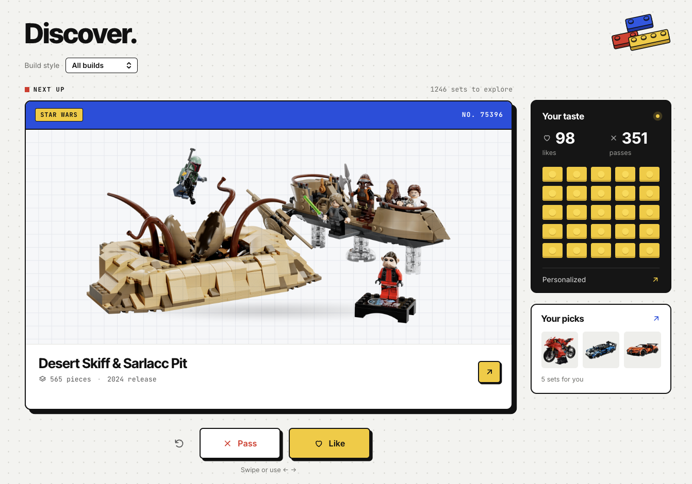
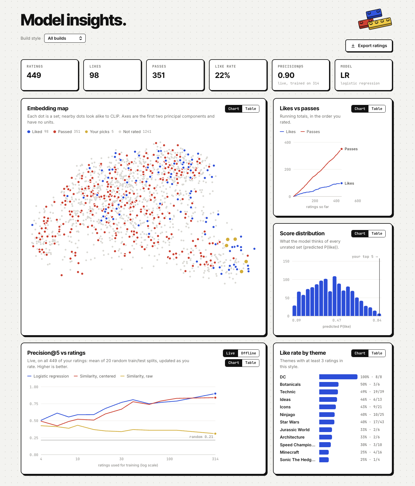
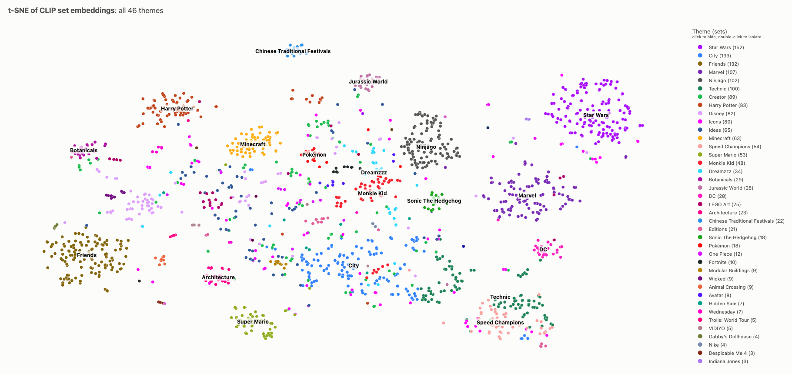

# [stud.io](https://studio-tau-silk.vercel.app)


A LEGO set recommender that learns your taste one swipe at a time.

You like or pass on sets in a swipe interface. Each rating retrains a small model on top of CLIP embeddings of the set photos and names, and **Your picks** shows the five unrated sets you're most likely to want. A **Model insights** page shows what the model has learned.

Built as a machine-learning / data-science project: offline data pipeline, embedding model, per-user classifier, evaluation against a baseline, a REST API, and a web frontend.



## How it works

```
Rebrickable CSVs ──► catalog ──► set images ──► CLIP embeddings ─┐
 (sets, themes)     1,695 sets   512px JPEGs    512-d per set    │
                                                                 ▼
 swipe UI ──► ratings (SQLite) ──► per-user model ──► top 5 picks
  like/pass      via FastAPI       refit every rating
```

1. **Catalog** (`ml/catalog.py`): sets from 2018–2026 (display builds) or 2020–2026 (play sets) with enough pieces, excluding gear, books, promos and seasonal items. Each set gets its top-level theme by walking the theme hierarchy. Data is extracted from [Rebrickable API](https://rebrickable.com).
2. **Embeddings** (`ml/embed.py`): OpenAI CLIP ViT-B/32 embeds each set's photo and the text `"a LEGO {theme} set called {name}"`. The two are L2-normalized and averaged into one 512-dimensional vector per set. CLIP stays frozen; it's never fine-tuned.
3. **Recommender** (`ml/recommender.py`):
  - **Baseline:** cosine similarity between each set and the average of the sets you liked, searched with FAISS. Embeddings are mean-centered first (see Results).
  - **Logistic regression:** trained on the embeddings of the sets you rated, with likes as 1 and passes as 0. It learns a "taste direction" in CLIP space, and unlike the baseline it learns from your passes too. It takes over from the baseline once you have 5 likes and 5 passes.
4. **API** (`api/`): FastAPI and SQLite. It stores ratings per anonymous browser id, refits the model on request, and serves recommendations and insights.
5. **Web app** (`web/`): React and Vite. You can swipe with the mouse or the arrow keys, undo a rating, and filter by build style (display builds, play sets, or all). The **Model insights** page charts:
  - an embedding map of every set (liked, passed, your picks)
  - running totals of likes and passes
  - the model's score distribution, with your top-5 cutoff
  - the Precision@5 learning curve, re-run live on your own ratings as you rate (or the offline `ml.evaluate` results, if present)
  - like rate by theme
   Every chart has a table view.



## Results

Evaluated with repeated stratified train/test splits (30 per experiment) over **281 real ratings** (38% likes) from the author.

**Metric:** Precision@5 (P@5) ranks only the *held-out rated* sets. Sets you never rated have no label, so they can't count as hits or misses. A random ranking scores the like rate, 0.39.


| Training ratings | Baseline (raw cosine) | Baseline (centered) | Logistic regression |
| ---------------- | --------------------- | ------------------- | ------------------- |
| 10               | 0.39                  | 0.47                | 0.56                |
| 30               | 0.35                  | 0.49                | 0.68                |
| 80               | 0.39                  | 0.56                | 0.86                |
| 196              | 0.31                  | 0.58                | **0.99**            |
| AUC at 196       | 0.54                  | 0.68                | 0.74                |


What the evaluation showed:

- **LR wins from about 10 ratings on, and the gap keeps growing.** The author's taste splits *within* themes (for example, some Icons sets liked and others passed). Averaging likes can't capture that, but a classifier trained on passes as well can.
- **The 0.99 is partly an easy cluster.** The author liked 15 of 16 Star Wars collector sets. With Star Wars removed, LR still reaches **0.80** against **0.48** for the centered baseline (random = 0.35).
- **Center the embeddings before using cosine similarity.** All CLIP embeddings of LEGO product photos fall in one tight cluster (set-to-set cosine above 0.8). So raw cosine mostly measures how *typical* a set looks, and the uncentered baseline scores at or below random. Subtracting the mean embedding fixes this. (It makes no difference to LR, whose intercept absorbs the shift.)
- **Regularization strength barely changes the ranking.** P@5 is about the same for C = 0.1, 1 and 10, but small C squeezes every predicted probability to about 0.5. The app uses C = 1.
- **Synthetic users** (rules like "likes Star Wars") are easier than real taste. Theme names are in the text prompt, so the embeddings nearly encode the label. Run `python -m ml.evaluate` without `--ratings` to see them.



## Running it

Requirements: Python 3.12 and Node 18 or newer. The first embedding run downloads about 600 MB of CLIP weights.

```bash
python -m venv venv && source venv/bin/activate
pip install -r requirements.txt

# Build the data (once). Run from the repo root.
python -m ml.catalog     # CSVs -> artifacts/catalog.parquet
python -m ml.images      # downloads ~80 MB of set images (rerunnable)
python -m ml.embed       # CLIP embeddings, about a minute on Apple Silicon

# Run the app: two terminals
uvicorn api.main:app --reload --port 8000
cd web && npm install && npm run dev      # open http://localhost:5173
```

The raw data goes in `data/all_downloads/`: `sets.csv` and `themes.csv` from the [Rebrickable downloads page](https://rebrickable.com/downloads/).

To evaluate your own taste, rate 60 or more sets, click **Export ratings** on the Model insights page, then run:

```bash
python -m ml.evaluate --ratings my_ratings.json
```

Interactive API docs are at [http://localhost:8000/docs](http://localhost:8000/docs) once the API is running.

## Project layout

```
ml/          offline pipeline: catalog, images, embed, recommender, evaluate
api/         FastAPI app (main.py), SQLite storage (db.py), request schemas
web/         React + Vite frontend
artifacts/   generated: catalog.parquet, embeddings, 2D projection, eval results
data/        raw CSVs, cached images, ratings database
```


## Limitations

- **One real user.** The results come from one person's 281 ratings. They show the method works, but they don't show how it generalizes to other people.
- **Each user's model only sees their own ratings,** so nothing is learned across users. New users start from scratch with the similarity baseline.
- **The order of sets in the deck is fixed.** It doesn't yet favor sets that would teach the model the most (active learning).


## Credits

Set data and images: [Rebrickable](https://rebrickable.com). This project is not affiliated with or endorsed by the LEGO Group. CLIP: [OpenAI](https://github.com/openai/CLIP) via [open_clip](https://github.com/mlfoundations/open_clip).